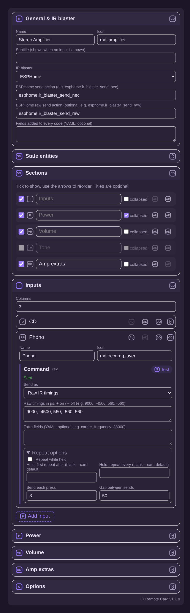

# IR Remote Card

A Home Assistant Lovelace card for IR-controlled kit, built for a stereo amplifier. It sends commands through an **ESPHome** or **Tasmota** IR blaster, a **text entity** that transmits whatever code is written to it, or through any HA action, script or button entity. It is styled to match the TrueNAS / Proxmox VE cards: a badge header with a status dot, a status pill and tinted, collapsible panels.

- **Power button in the header** (compact; or a full Power section if you prefer), **Volume** (hold to repeat), **Mute**, **Inputs**, **Tone** (bass/treble style −/+ rows) and **Extras**
- Remembers the current input, power and mute state (IR is one-way, so these are *assumed* unless you give it real entities)
- Optional real state: a smart-plug power sensor for on/off, an `input_select` for the input, a number/sensor for a volume bar
- Macros: a list of commands with optional delays (e.g. power on → wait → select TV)
- Background options shared with the TrueNAS card: `background_opacity`, `glass_background`, `card_background`
- **Visual editor**: turn sections on or off, reorder and rename them, add, reorder and remove buttons, pick how each command is sent, set repeat options, and **Test** each command from the editor

 

*(Preview from the test harness: icons are placeholders.)*

## Install

**HACS:** HACS → ⋮ → Custom repositories → `https://github.com/sargeantpepper/IRRemoteCustomCard`, type *Dashboard*, then install **IR Remote Card**.

**Manual:**

1. Copy `ir-remote-card.js` to `/config/www/ir-remote-card.js`.
2. **Settings → Dashboards → ⋮ → Resources → Add**: `/local/ir-remote-card.js?v=1.3.0`, type *JavaScript module*.
3. Bump `?v=` after every update. HA caches hard.

## Visual editor

Add the card from the dashboard card picker and everything can be set in the editor:

- **General & IR blaster**: name, icon, power button in the header or a Power section, ESPHome, Tasmota or a text entity, plus the send action, topic or entity, and fields added to every code.
- **State entities**: optional real power, input, volume and mute state.
- **Sections**: tick to show or hide, arrows to reorder, an optional title for each, and whether it starts collapsed.
- **One block per section**: every button has a command editor. *Send as* picks the kind of command:
  - **IR code**: ESPHome address and command, Tasmota protocol, bits and data, or for a text entity simply the code text
  - **Raw IR timings**: microseconds, + for on and − for off (ESPHome needs a raw send action, see below)
  - **Button / script / scene**
  - **Home Assistant action**: any action with YAML data, e.g. `esphome.ir_blaster_send_pronto`
  - **Sequence (macro)**: a YAML list of commands with `{delay: ms}` steps
  - **Not used**: hides the button
- **Repeat options** for each command: repeat while held (on by default for volume and tone), its own hold timings, send each press N times, and the gap between sends.
- **Test** sends the command straight away, so you can check a code before saving.

Anything set in the editor can also be written in YAML, as below.

## ESPHome setup

Add a transmitter, plus a receiver if you need to learn your amp's codes, and expose an action that takes the code:

```yaml
esphome:
  name: ir-blaster

remote_transmitter:
  pin: GPIO4
  carrier_duty_percent: 50%

remote_receiver:            # optional: for learning codes
  pin: { number: GPIO14, inverted: true, mode: INPUT_PULLUP }
  dump: all

api:
  actions:
    - action: send_nec
      variables:
        address: int
        command: int
      then:
        - remote_transmitter.transmit_nec:
            address: !lambda 'return address;'
            command: !lambda 'return command;'
```

For **raw timings** add a second action and set it as the *raw send action* (`transport.raw_service`):

```yaml
    - action: send_raw
      variables:
        code: int[]
      then:
        - remote_transmitter.transmit_raw:
            code: !lambda 'return code;'
            carrier_frequency: 38kHz
```

HA then has `esphome.ir_blaster_send_nec` (and `esphome.ir_blaster_send_raw`) (node name with `-` → `_`, then `_` + action name).

**Learning codes:** open the device logs in ESPHome, point the amp's remote at the receiver and press each key. You'll see lines like `Received NEC: address=0x7A85, command=0x1A`. Those two numbers go into the card.

Other protocols (RC5, Sony, Samsung, raw…) work the same way. Add another action, e.g. `send_rc5` with `transmit_rc5`, and either set it as the transport `service` or override it per command with `service_override: esphome.ir_blaster_send_rc5`.

## Power button

By default power is a round button in the top right of the card, in place of the status pill. Its colour shows the state: green for on, grey for off, amber for unknown. A dashed ring means the state is assumed. Pressing it sends:

- **Off** when the amp is on, and **On** when it's off, if you've set discrete `power_on` / `power_off` codes
- otherwise the **toggle** code (`power`)

Set `power_button: section` to get the old Power panel with separate On / Toggle / Off buttons instead.

## Text entity setup

If your IR sender sends whatever code you write to a `text` (or `input_text`) entity, the way you'd do it by hand with **Developer tools → Actions → `text.set_value`**, choose **Text entity** as the IR blaster. Each button is then just the code text, and the card calls:

```yaml
action: text.set_value
target: { entity_id: text.ir_sender_2_ir_code_to_send }
data: { value: <code> }
```

- **Prefix / suffix**: added to every code, if your sender expects a common format.
- **Then set it back to**: optionally writes a second value afterwards (after 100 ms by default). Use this if your sender only transmits when the text *changes*, so pressing the same button twice, or holding volume, still sends every time.

```yaml
type: custom:ir-remote-card
name: Stereo Amplifier
transport:
  type: text
  entity: text.ir_sender_2_ir_code_to_send
  # reset_value: idle
  # reset_delay: 100
commands:
  power: { code: "your power code" }
  volume_up: { code: "your volume up code" }
  volume_down: { code: "your volume down code" }
  mute: { code: "your mute code" }
inputs:
  - { name: CD, icon: mdi:disc, command: { code: "your CD code" } }
```

With a text entity, a plain string also works as a code (`power: "your power code"`), except strings that look like `button.x`, `script.x` or `scene.x`, which still press or run that entity.

## Tasmota setup

With Tasmota-IR flashed and the MQTT integration in HA, the card publishes to `cmnd/<topic>/IRSend`. Learn codes from the Tasmota console: each received key shows `{"IrReceived":{"Protocol":"NEC","Bits":32,"Data":"0x5EA1F807"}}`.

## Example: ESPHome

```yaml
type: custom:ir-remote-card
name: Stereo Amplifier
icon: mdi:amplifier
transport:
  type: esphome
  service: esphome.ir_blaster_send_nec
# Optional real state (otherwise assumed from the last command sent):
# power_entity: sensor.amp_plug_power    # >5 W = on (power_threshold)
# input_entity: input_select.amp_input   # options must match the input names
# volume_entity: number.amp_volume       # shows a volume bar
commands:
  power: { address: 0x7A85, command: 0x1F }
  # power_on / power_off if your amp has discrete codes
  volume_up: { address: 0x7A85, command: 0x1A }
  volume_down: { address: 0x7A85, command: 0x1B }
  mute: { address: 0x7A85, command: 0x1C }
inputs:
  - { name: CD, icon: mdi:disc, command: { address: 0x7A85, command: 0x15 } }
  - { name: Tuner, icon: mdi:radio, command: { address: 0x7A85, command: 0x16 } }
  - { name: Phono, icon: mdi:record-player, command: { address: 0x7A85, command: 0x14 } }
  - { name: Aux, icon: mdi:audio-input-rca, command: { address: 0x7A85, command: 0x13 } }
  - name: TV                                  # macro: power on, wait, then select input
    icon: mdi:television
    command:
      - { address: 0x7A85, command: 0x1D }
      - delay: 1500
      - { address: 0x7A85, command: 0x12 }
adjust:
  - { name: Bass, icon: mdi:speaker, down: { address: 0x7A85, command: 0x30 }, up: { address: 0x7A85, command: 0x31 } }
  - { name: Treble, icon: mdi:music-clef-treble, down: { address: 0x7A85, command: 0x32 }, up: { address: 0x7A85, command: 0x33 } }
buttons:
  - { name: Loudness, icon: mdi:equalizer, command: { address: 0x7A85, command: 0x40 } }
  - { name: Direct, icon: mdi:arrow-right-bold, command: { address: 0x7A85, command: 0x41 } }
collapsed: [adjust]
```

## Example: Tasmota

```yaml
type: custom:ir-remote-card
name: Stereo Amplifier
transport:
  type: tasmota
  topic: tasmota_ir           # device topic; or full_topic: cmnd/tasmota_ir/IRSend
  data: { protocol: NEC, bits: 32 }   # defaults merged into every command
commands:
  power: { data: "0x5EA1F807" }
  volume_up: { data: "0x5EA158A7" }
  volume_down: { data: "0x5EA1D827" }
  mute: { data: "0x5EA138C7" }
inputs:
  - { name: CD, icon: mdi:disc, command: { data: "0x5EA1A857" } }
  - { name: Aux, command: { raw: "0,9000,4500,560,…" } }   # raw IRSend payload
```

## Commands

Anywhere a command is expected you can use:

| Form | Sends |
|---|---|
| `{ address: 0x.., command: 0x.. }` (ESPHome) | `transport.service` with those fields; `"0x.."` strings become numbers |
| `{ protocol, bits, data }` / `{ raw }` (Tasmota) | `mqtt.publish` to `cmnd/<topic>/IRSend` |
| `button.amp_dimmer` / `input_button.x` | `button.press` |
| `script.amp_on` / `scene.x` | `turn_on` |
| `{ action: domain.service, data: {…} }` | any HA action |
| `{ code: "…" }` or a plain string (text entity) | `text.set_value` on `transport.entity` |
| `{ raw: "9000, -4500, 560, …" }` (ESPHome) | `transport.raw_service` with `code: [9000, -4500, 560, …]` |
| `{ sequence: [...] }` or a plain list, with `{ delay: ms }` steps | a macro, run in order |

### Repeat options (on any command)

```yaml
volume_up:
  address: 0x7A85
  command: 0x1A
  hold_repeat: true       # repeat while held (default on for volume and tone, off elsewhere)
  repeat_delay: 300       # ms before the first repeat (default: card repeat_delay)
  repeat_interval: 120    # ms between repeats (default: card repeat_interval)
  times: 2                # send this many times per press
  gap: 80                 # ms between those sends (default 100)
```

These keys are never sent to the IR blaster. Protocol-level repeats are separate: Tasmota's `repeat`, or any field your ESPHome action takes, go through as normal fields.

## Options

| Option | Default | |
|---|---|---|
| `name`, `icon`, `subtitle` | Stereo Amplifier, `mdi:amplifier` | subtitle shows when no input or mute is known |
| `transport.type` | `esphome` | `esphome`, `tasmota`, `text` or `none` (action/entity commands only) |
| `transport.entity` | – | text entity: the `text`/`input_text` entity that sends the code |
| `transport.prefix` / `suffix` | – | text entity: added around every code |
| `transport.reset_value` / `reset_delay` | – / 100 ms | text entity: value written after each code |
| `transport.service` | – | ESPHome action, e.g. `esphome.ir_blaster_send_nec` |
| `transport.raw_service` | – | ESPHome action for raw timings, e.g. `esphome.ir_blaster_send_raw` |
| `transport.topic` / `full_topic` | – | Tasmota |
| `transport.data` | – | fields merged into every command |
| `power_entity` | – | `on`/`off`, or a numeric power sensor (`power_threshold`, default 5 W) |
| `input_entity` | – | `input_select`, `select` or `input_text`; the card sets it when you press an input |
| `volume_entity` | – | number/sensor; `volume_min`/`volume_max`/`volume_unit` override its attributes |
| `mute_entity` | – | on/off entity for real mute state |
| `power_button` | `header` | `header` (one button top right) or `section` (Power panel) |
| `sections` | `[power, volume, inputs, adjust, buttons]` | order and which to show (`power` only applies with `power_button: section`) |
| `section_titles` | – | e.g. `{ adjust: Tone & Balance }` |
| `collapsed` | `[]` | sections that start collapsed (the user's choice is then remembered) |
| `inputs_columns`, `buttons_columns` | 3 | |
| `repeat_delay`, `repeat_interval` | 400, 180 ms | default hold-to-repeat timing (each command can override) |
| `unmute_on_volume` | true | assumed mute clears when volume changes |
| `input_powers_on` | true | selecting an input marks the amp as on (assumed state) |
| `macro_delay` | 0 | extra ms between macro steps |
| `background_opacity` | 100 | 0–100 |
| `glass_background` | false | backdrop blur |
| `card_background` | – | CSS colour |
| `storage_key` | name | where the assumed state is kept in the browser |
| `debug` | false | log every call to the console |

Assumed state lives in each browser's local storage, so two phones can disagree. Set `power_entity`, `input_entity` and so on if you want one shared truth. A smart plug with power monitoring is the easy way to get real on/off.

## License

MIT, see [LICENSE](LICENSE).
